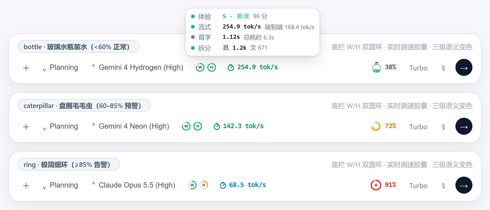
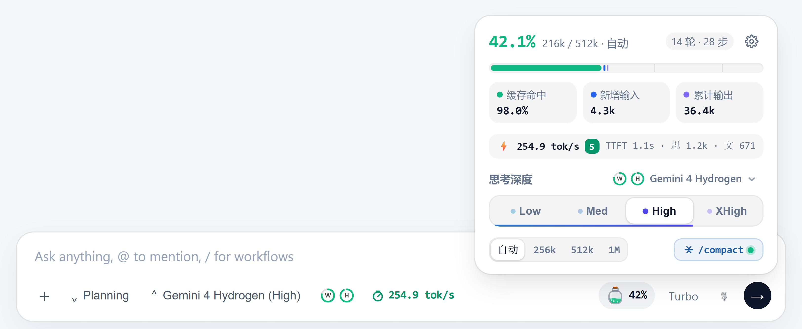
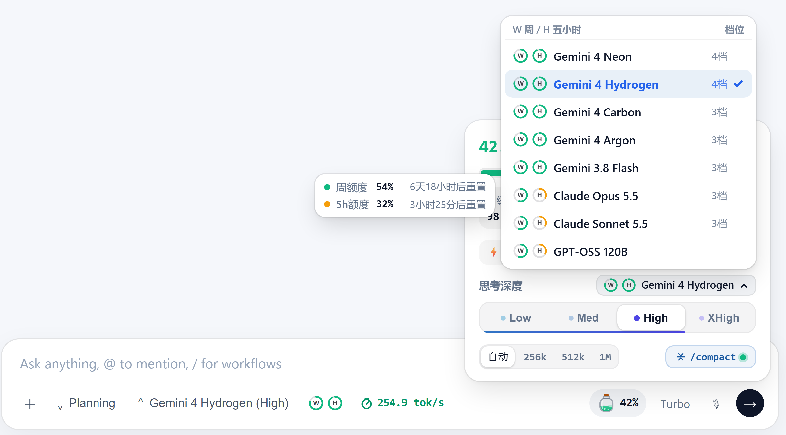
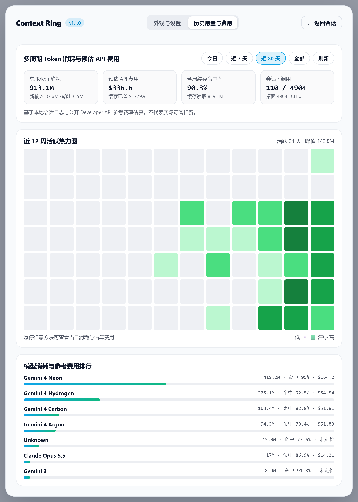
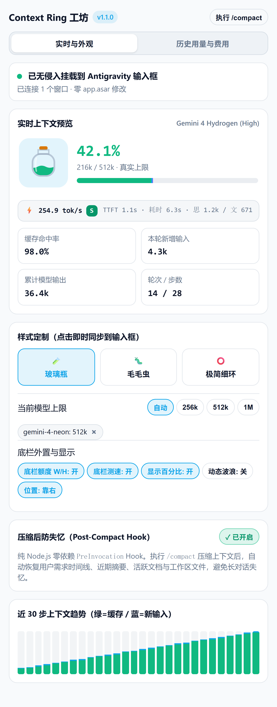

<div align="center">
  
  <h1>Context Ring</h1>
  <p><strong>面向 Google Antigravity 2.0 的无侵入多形态上下文监控、实时测速与用量看板插件</strong></p>
  <p>
    零侵入 <code>app.asar</code> · 纯 Node.js 零外部依赖 · Windows / macOS / Linux / WSL2 双模
  </p>
</div>

---

**Context Ring** 直接挂载在 Antigravity 聊天输入框底部工具栏，让你在对话过程中无需切屏就能一眼掌握：
当前上下文窗口占用水位、实时流式生成速度（`tok/s` / `TTFT` / `S–D` 体验评级）、模型池剩余额度（`W` 周额度与 `H` 5 小时额度双圆环）、按模型自动识别的真实上限、多周期历史用量热力图与参考费用，以及一键 `/compact` 配合的**压缩后防失忆 Hook**。

> **为什么做这个插件？**
> - **零侵入 `app.asar`**：通过客户端本地调试端口（`--remote-debugging-port=0`）与官方标准 Sidecar / Hook 机制挂载，**绝不修改客户端安装文件**，Antigravity 自动升级后依然直接可用。
> - **零 DOM 劫持，多插件友好共存**：不破坏原生 `document.querySelectorAll`，底栏 `W/H` 额度圆环与测速胶囊会主动礼让 `Agy Powertools` 等同级插件节点；卸载时自动检测同伴插件，不会破坏共享的调试启动参数。
> - **零外部依赖**：全部功能（包括压缩后防失忆 Hook）均基于纯 Node.js 原生模块实现，无需 Python、无需 `npm install`；Windows 下会自动优先复用客户端内置 `agy-node.cmd`，开箱即装。

---

## 界面预览

### 1. 三种精选动态形态 & 底栏外置 `W/H` 额度与实时测速胶囊

底栏支持独立开关外置 **`W`（周）/ `H`（5 小时）双圆环** 与 **实时测速胶囊（`tok/s`）**，悬停测速胶囊可秒出响应体验评分（`S/A/B/C/D`）、流式与端到端速度、首字延迟 `TTFT` 及思考 / 正文 Token 拆分；三种形态均采用**绿（&lt;60%）→ 琥珀黄（60%–85%）→ 红（≥85%）**三级自动语义变色：

<p align="center">
  
</p>

### 2. 悬浮精密仪表卡片 & 模型系列切换配额提示

<table>
  <tr>
    <td align="center" width="50%" valign="top">
      
      <br />
      <sub><b>悬浮仪表卡片</b>：分段上下文进度槽（缓存命中 / 新增输入 / 累计输出 + 60% / 85% 警戒线）、实时速度体检条、磁吸思考深度滑轨、<code>自动 / 256k / 512k / 1M</code> 上限切换，以及带防失忆状态点的 <code>/compact</code> 一键压缩</sub>
    </td>
    <td align="center" width="50%" valign="top">
      
      <br />
      <sub><b>模型系列切换与配额明细</b>：去重后的模型系列下拉列表，左侧内嵌 <code>W</code> / <code>H</code> 额度双圆环；悬停任意模型即刻弹出剩余额度百分比与重置倒计时，切换模型时自动匹配最接近的思考深度</sub>
    </td>
  </tr>
</table>

### 3. 双页签设置与用量大页（外观定制 · 历史热力图与费用）

<table>
  <tr>
    <td align="center" width="50%" valign="top">
      
      <br />
      <sub><b>外观与设置</b>：3 种动态形态大号实时预览（支持拖动水位滑块试看）、按模型记忆上限标签、底栏 <code>W/H</code> 与 <code>tok/s</code> 独立显示开关、压缩后防失忆 Hook 一键启停，以及当前会话近 30 步上下文趋势</sub>
    </td>
    <td align="center" width="50%" valign="top">
      
      <br />
      <sub><b>历史用量与费用</b>：覆盖 <b>今日 / 近 7 天 / 近 30 天 / 全部</b> 周期的桌面端 + CLI Token 统计、全局缓存命中率、按公开 Developer API 费率估算的参考费用与缓存节省金额、近 12 周活跃热力图及模型消耗排行</sub>
    </td>
  </tr>
</table>

### 4. 右侧 Sidecar 实时监控工坊

<p align="center">
  
  <br />
  <sub><b>右侧 Sidecar 工坊</b>：通过 <code>sidecar://context-ring/monitor/ui.html</code> 随时在右侧边栏打开，与输入框卡片双向实时同步配置、运行状态与历史用量数据</sub>
</p>

---

## 核心功能亮点

### 三种精选动态形态

| 形态代号 | 名称 | 视觉效果说明 |
| :--- | :--- | :--- |
| `bottle` *(默认)* | **玻璃水瓶装水** | 带软木塞与玻璃高光折射条的透明魔药瓶，瓶内双层正弦波浪液面随占用率升降晃动，液面 ≥10% 时伴随上升小气泡 |
| `caterpillar` | **盘圈毛毛虫** | 圆润珠串身体沿圆周逐节生长，带触角与眨眼小虫头沿圆弧爬行推进，伴随轻微呼吸蠕动波浪 |
| `ring` | **极简细环** | 纤细圆环进度条搭配中心呼吸光点，轻量克制 |

*(若从旧版升级前曾选用已移除形态，插件会自动平滑回退至默认 `bottle` 形态。)*

### 核心能力拆解

- **实时生成速度与响应体检（TPS / TTFT）**：零侵入直连宿主只读元数据，实时计算并展示流式输出速度（`tok/s`，区分预热阶段 `warming` 与稳态流式速度）、端到端速度、首字延迟 `TTFT`、`S/A/B/C/D` 响应体验综合评级，以及最新一轮**思考 Token vs 正文 Token** 拆分。
- **底栏外置 `W/H` 额度圆环与测速胶囊**：在输入框左下角模型选择器旁直观常驻周额度（`W`）与 5 小时额度（`H`）双圆环及实时测速胶囊，悬停即可查看详情；两者均支持在设置页、Sidecar 工坊或命令行**独立开启 / 关闭**。
- **自动识别模型真实上限 + 按模型系列记忆**：默认开启 **`自动`** 模式（`contextLimit = 0`），自动读取宿主响应中的 `maxContextTokens` 与模型目录真实上限；当你在底部切换为 `256k / 512k / 1M` 时，会自动按当前模型系列（忽略思考深度后缀）分别记忆，点回 `自动` 即恢复官方上限。
- **多周期历史用量看板 + 12 周热力图 + 预估 API 费用**：扫描本地桌面端与 CLI 会话日志，统计 **今日 / 近 7 天 / 近 30 天 / 全部** 的总 Token 消耗、全局缓存命中率、近 12 周 GitHub 风格活跃热力图与各模型占比，并按公开 Developer API 参考费率估算等价费用与缓存节省金额 *（注：仅供参考，不代表实际订阅扣费）*。
- **纯 Node.js 压缩后防失忆（Post-Compact Rehydration）**：与悬浮卡片的一键 `/compact` 深度协同，内置零依赖 `PreInvocation` Hook（默认关闭，可在设置页、Sidecar 工坊或 CLI 一键启停）。当会话发生 `CHECKPOINT` 上下文压缩后，自动把用户需求时间线、近期进展摘要、活跃规范文档与工作区白名单文件安全脱敏并注入回上下文，显著缓解长对话压缩失忆；卸载时自动无痕清理 `hooks.json`。
- **空白新会话隔离**：新建空白对话时严格归零显示 `0%`，绝不误带入上一条会话的缓存上下文或速度数据。

---

## 快速安装

**环境要求**：Node.js `20+`（Windows 下若已安装 Antigravity，安装与卸载脚本会自动优先复用客户端内置的 `agy-node.cmd` 运行时）。支持 **Windows / macOS / Linux / WSL2**。

### Windows

```powershell
git clone https://github.com/yoyoyoyo1/context-ring.git
cd context-ring
.\install.cmd
```

*(或使用 PowerShell：`powershell -NoProfile -ExecutionPolicy Bypass -File .\install.ps1`；Windows 安装器还会自动检测本地 WSL2 发行版并同步插件副本。)*

### macOS / Linux / WSL2

```bash
git clone https://github.com/yoyoyoyo1/context-ring.git
cd context-ring
sh ./install.sh
```

### 生效说明

- 如果当前客户端已经开启了调试端口（例如已安装过 `Agy Powertools` 等同伴插件），安装完成后会**免重启直接热挂载**到当前窗口输入框。
- 如果是首次安装，请**完全退出 Antigravity 后通过桌面或开始菜单快捷方式重新打开**（安装器已自动为快捷方式追加 `--remote-debugging-port=0`）。

---

## CLI 查询、配置与无痕卸载

```powershell
# 查看插件安装、CDP 挂载与防失忆 Hook 状态
node scripts/install.mjs status

# 查询当前会话实时上下文占用、自动上限与实时生成速度
node scripts/cli-stats.mjs

# 查看近 30 天历史 Token 用量、热力图概要与预估 API 费用（支持 today / 7d / 30d / all）
node scripts/cli-stats.mjs --history 30d

# 切换形态（bottle / caterpillar / ring）或恢复自动识别上限
node scripts/cli-stats.mjs --style bottle --limit auto

# 按模型系列单独设定上下文上限（设回 auto 或 0 即恢复自动）
node scripts/cli-stats.mjs --model-limit "gemini-4-neon=512000"

# 独立开关输入框底栏外置的 W/H 额度双圆环与实时测速胶囊
node scripts/cli-stats.mjs --footer-quota on --footer-speed on

# 一键启停或查询纯 Node.js 压缩后防失忆 Hook
node scripts/cli-stats.mjs --rehydrate on
node scripts/cli-stats.mjs --rehydrate off
node scripts/cli-stats.mjs --rehydrate status
```

### 卸载

```powershell
# Windows 一键无痕卸载（自动分离运行中组件并清理防失忆 Hook）
.\uninstall.cmd

# Windows 卸载但保留个人样式与模型上限配置
powershell -NoProfile -ExecutionPolicy Bypass -File .\uninstall.ps1 -KeepSettings
```

```bash
# macOS / Linux / WSL2 卸载
sh ./uninstall.sh
```

---

## 项目结构与开发测试

```text
context-ring/
├── assets/                 # 插件 Logo 与界面预览截图
├── lib/                    # 核心模块：CDP 宿主注入、遥测测速、历史账本、防失忆管理、设置存储等
├── renderer/               # 注入到 Antigravity 输入框底栏的前端 UI 组件与双页签设置大页
├── sidecars/monitor/       # 官方标准 Sidecar 监控服务端与右侧工坊入口
├── scripts/                # 安装/卸载脚本、CLI 查询工具与独立 PreInvocation 防失忆 Hook
├── rules/ & skills/        # Agent 规则与技能引导
└── tests/                  # 自动化单元测试套件
```

运行内置自动化测试套件：

```bash
npm test
```

## 开源协议

[MIT License](LICENSE)
