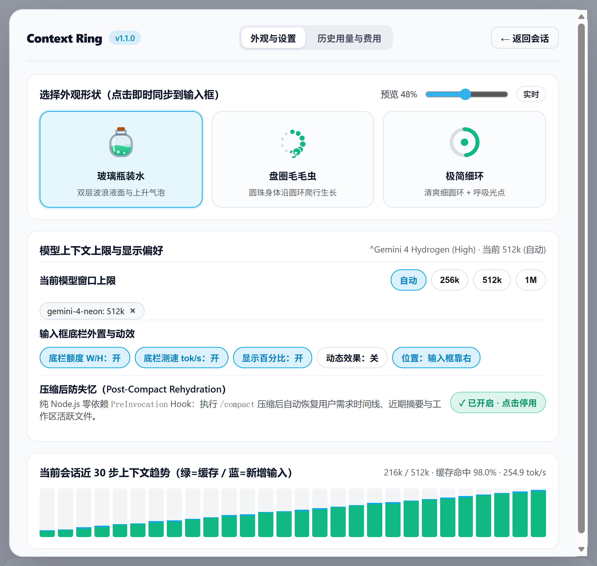

# Context Ring — Antigravity 无侵入多形态上下文与用量监控插件

面向 **Google Antigravity 2.0** 桌面客户端的零侵入上下文监控、速度体检与用量看板插件。直接挂载在聊天输入框底部工具栏，实时展示当前会话的上下文窗口占用百分比、缓存命中率、实时生成速度（TPS / TTFT / 思考与正文拆分）、按模型自动识别真实上限，内置 **3 种精选动态形态**、**历史用量热力图与预估 API 费用**，以及可选的 **纯 Node.js 零依赖压缩后防失忆 Hook**。

> **为什么做这个插件？**
> - **零侵入 `app.asar`**：通过本机调试接口（`--remote-debugging-port=0`）与官方标准 Sidecar / Hook 注入，**绝不修改客户端安装文件**，Antigravity 自动升级后依然直接可用。
> - **零 DOM 劫持**：不污染原生 `document.querySelectorAll`，与 `Agy Powertools`、`agy-fast` 等插件无冲突共存（卸载时还会自动检测同伴插件，不破坏共享的快捷方式调试参数）。
> - **零外部依赖**：纯 Node.js 原生模块实现（连压缩后防失忆 Hook 也无需 Python），无需 `npm install`，开箱即装。

---

## 界面预览

<table>
  <tr>
    <td align="center" width="50%">
      
      <br />
      <sub><b>悬浮仪表卡片</b>：上下文进度槽、三项指标、实时速度体检、<code>W</code>/<code>H</code> 配额环、磁吸思考深度滑轨、按模型上限与一键 <code>/compact</code></sub>
    </td>
    <td align="center" width="50%">
      
      <br />
      <sub><b>模型系列切换与配额提示</b>：去重模型列表、左侧 <code>W</code>（周）/ <code>H</code>（5小时）双圆环与悬停秒出明细</sub>
    </td>
  </tr>
</table>

<p align="center">
  
  <br />
  <sub><b>双页签设置与用量大页</b>：3 种动态形态大号预览、压缩后防失忆开关、近 30 步趋势图，以及多周期历史热力图与预估 API 费用</sub>
</p>

---

## 核心能力与 3 种精选动态形态

- **实时生成速度与响应体检（TPS / TTFT）**：零侵入直连宿主只读轨迹元数据，在悬浮卡片与监控工坊中实时展示流式输出速度（`tok/s`，区分 `warming` 与稳态流式速度）、首字延迟 `TTFT`、`S/A/B/C/D` 响应体验评级，以及最新一轮**思考 Token vs 正文 Token** 拆分。
- **自动识别模型真实上限 + 按模型记忆**：默认开启 **自动模式**，自动读取宿主响应中的真实 `maxContextTokens` 与模型目录 `maxTokens`；在底部切换 `256k / 512k / 1M` 时自动按当前模型系列分别记忆，点回 `自动` 即恢复官方真实上限。
- **历史 Token 用量看板 + 12 周活跃热力图 + 预估 API 费用**：在独立设置大页与右侧 Sidecar 工坊切换至「历史用量与费用」页签，查看 **今日 / 近 7 天 / 近 30 天 / 全部** 的桌面端 + CLI 总 Token、全局缓存命中率、近 12 周 GitHub 风格活跃热力图、各模型消耗排行与按公开 Developer API 费率估算的参考费用及缓存节省金额（注：不代表实际订阅扣费）。
- **压缩后防失忆（Post-Compact Rehydration）**：与悬浮卡片的一键 `/compact` 深度配合，内置纯 Node.js 零依赖 `PreInvocation` Hook（默认关闭，可在设置页/工坊一键启停）。会话发生 `CHECKPOINT` 压缩后，自动把用户需求时间线、近期进展摘要、活跃规范文档与工作区白名单文件安全脱敏并注入回上下文，避免长对话失忆；卸载时自动无痕清理 `hooks.json`。
- **模型系列切换器（带 `W` 周 / `H` 5h 双圆环）+ 磁吸思考深度滑轨**：点击模型名即可切换模型系列并自动匹配最接近的思考深度，悬停任意模型即刻显示精确剩余额度与重置倒计时。

| 形态代号 | 名称 | 视觉效果说明 |
| :--- | :--- | :--- |
| `bottle` *(默认)* | **玻璃水瓶装水** 🧪 | 带软木塞与玻璃高光折射条的透明魔药瓶，瓶内双层正弦波浪液面随占用率升降晃动，附带上升小气泡 |
| `caterpillar` | **盘圈毛毛虫** 🐛 | 圆润珠串身体沿圆环逐节生长，带触角与眼睛的小虫头沿圆弧爬行推进，伴随呼吸蠕动波浪 |
| `ring` | **极简细环** ⭕ | 纤细圆环进度条 + 中心呼吸圆点，清爽克制 |

配色统一采用**绿（<60%）→ 琥珀黄（60%–85%）→ 红（≥85%）**三级自动语义告警（若从旧版升级前曾选用已移除形态，会自动平滑回退至默认 `bottle`）。

---

## 快速安装

**环境要求**：Node.js `20+`（Windows 下若已安装 Antigravity，会自动优先复用客户端内置 Node 运行时）。支持 **Windows / macOS / Linux / WSL2 双模**。

### Windows

```powershell
git clone https://github.com/yoyoyoyo1/context-ring.git
cd context-ring
.\install.cmd
```

*(或使用 PowerShell：`powershell -NoProfile -ExecutionPolicy Bypass -File .\install.ps1`)*

### macOS / Linux / WSL2

```bash
git clone https://github.com/yoyoyoyo1/context-ring.git
cd context-ring
sh ./install.sh
```

### 生效说明
- 如果当前客户端已经开启了调试端口（例如已装过 `Agy Powertools`），安装完成后会**免重启直接热挂载**到当前窗口输入框！
- 如果是首次安装，请**完全退出 Antigravity 后从桌面或开始菜单快捷方式重新打开**（安装器已自动为快捷方式追加 `--remote-debugging-port=0`）。

---

## CLI 查询、开关与卸载

```powershell
# 查看安装、挂载与防失忆 Hook 状态
node scripts/install.mjs status

# 查询当前会话实时上下文、速度与自动上限
node scripts/cli-stats.mjs

# 查看近 30 天历史 Token 用量、热力图概要与预估 API 费用（支持 today / 7d / 30d / all）
node scripts/cli-stats.mjs --history 30d

# 切换形态（bottle / caterpillar / ring）或恢复自动上限
node scripts/cli-stats.mjs --style bottle --limit auto

# 启停纯 Node.js 压缩后防失忆 Hook
node scripts/cli-stats.mjs --rehydrate on
node scripts/cli-stats.mjs --rehydrate off

# Windows 一键无痕卸载（自动移除运行中组件与防失忆 Hook）
.\uninstall.cmd

# 卸载但保留个人样式配置
powershell -NoProfile -ExecutionPolicy Bypass -File .\uninstall.ps1 -KeepSettings
```

---

## 开发与测试

```bash
# 运行内置自动化测试套件
npm test
```

## 开源协议

[MIT License](LICENSE)
